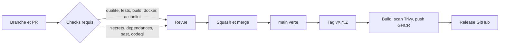

# socle-web

Un socle Next.js (TypeScript) prêt à cloner, qui applique les bonnes pratiques DevOps et DevSecOps dès le premier commit.

[](https://github.com/Jeeiib/socle-web/actions/workflows/ci.yml)
[](https://github.com/Jeeiib/socle-web/actions/workflows/security.yml)
[](LICENSE)

Le dépôt est un modèle GitHub : on l'utilise pour démarrer un projet qui a déjà sa CI, ses scans de sécurité, son image Docker durcie et ses règles de contribution. Il s'appuie sur le cours [formation-cda-devops](https://github.com/Foreach-Academy-France/formation-cda-devops) de Foreach Academy, dont il corrige aussi quelques incohérences (voir [Écarts assumés avec le cours](#écarts-assumés-avec-le-cours)).

## Ce que contient le socle

| Thème                | Outil                                   | Fichier                                                      |
| -------------------- | --------------------------------------- | ------------------------------------------------------------ |
| Application          | Next.js 16, React 19, TypeScript strict | `src/`, `tsconfig.json`                                      |
| Santé                | Route `/api/health`                     | `src/app/api/health/route.ts`, `src/lib/health.ts`           |
| Qualité              | ESLint, Prettier                        | `eslint.config.mjs`, `.prettierrc.json`                      |
| Tests                | Vitest, seuil de couverture 80 %        | `vitest.config.ts`                                           |
| Conventions          | Conventional Commits, hooks Git         | `.githooks/commit-msg`, `.githooks/pre-commit`               |
| Protection de `main` | Ruleset GitHub versionné                | `.github/rulesets/main.json`, `scripts/appliquer-ruleset.sh` |
| Intégration continue | GitHub Actions                          | `.github/workflows/ci.yml`                                   |
| Sécurité             | gitleaks, pnpm audit, Semgrep, CodeQL   | `.github/workflows/security.yml`, `.gitleaks.toml`           |
| Image                | Docker multi-étapes, utilisateur `node` | `Dockerfile`, `compose.yaml`, `.dockerignore`                |
| Scan d'image         | Trivy                                   | `.github/workflows/ci.yml`, `.trivyignore`                   |
| Livraison            | Release sur tag, image sur GHCR         | `.github/workflows/release.yml`                              |
| Mises à jour         | Dependabot                              | `.github/dependabot.yml`                                     |
| Revue                | CODEOWNERS, modèles de PR et d'issue    | `.github/CODEOWNERS`, `.github/pull_request_template.md`     |

## Démarrer en 5 minutes

Prérequis : Node 24 (voir `.nvmrc`) et pnpm 10 (via `corepack enable`).

1. Sur GitHub, cliquer sur **Use this template** puis **Create a new repository**.
2. Cloner votre nouveau dépôt :

   ```bash
   git clone git@github.com:<vous>/<votre-projet>.git
   cd <votre-projet>
   ```

3. Installer et lancer :

   ```bash
   pnpm install
   pnpm dev
   ```

   L'application répond sur <http://localhost:3000>, la santé sur <http://localhost:3000/api/health>.

Variante Docker, sans Node installé :

```bash
docker compose up --build
```

Pour finir la mise en place (ruleset, réglages du dépôt, premier tag), suivre [docs/demarrer-un-projet.md](docs/demarrer-un-projet.md).

## Scripts

| Commande             | Rôle                                          |
| -------------------- | --------------------------------------------- |
| `pnpm dev`           | Serveur de développement                      |
| `pnpm build`         | Build de production                           |
| `pnpm start`         | Lance le build de production                  |
| `pnpm lint`          | ESLint                                        |
| `pnpm typecheck`     | Vérification TypeScript (`tsc --noEmit`)      |
| `pnpm format`        | Formate tout le dépôt avec Prettier           |
| `pnpm format:check`  | Vérifie le formatage sans écrire              |
| `pnpm test`          | Tests Vitest                                  |
| `pnpm test:coverage` | Tests avec couverture (seuil bloquant à 80 %) |

Avant de pousser : `pnpm lint && pnpm typecheck && pnpm format:check && pnpm test:coverage && pnpm build`.

## Arborescence

```text
.
├── .githooks/              Hooks Git (commit-msg, pre-commit), activés par `pnpm install`
├── .github/
│   ├── workflows/          ci.yml, security.yml, release.yml
│   ├── rulesets/main.json  Règles de protection de la branche main
│   ├── dependabot.yml      Mises à jour automatiques
│   ├── CODEOWNERS          Relecteurs obligatoires
│   └── ISSUE_TEMPLATE/     Modèles d'issues
├── docs/                   Guides détaillés
├── scripts/                appliquer-ruleset.sh, test-commit-msg.sh
├── src/
│   ├── app/                Pages et route /api/health
│   └── lib/health.ts       Logique de santé, testée
├── Dockerfile              Image multi-étapes, non-root
├── compose.yaml            Lancement local durci
├── .gitleaks.toml          Configuration des scans de secrets
└── .trivyignore            Exceptions Trivy (vide à dessein)
```

## Pipeline



Les cinq checks en trait plein sont requis par le ruleset de `main`. Le workflow Sécurité tourne aussi sur chaque PR, et chaque lundi pour détecter les CVE publiées entre deux commits. Détails dans [docs/ci-cd.md](docs/ci-cd.md).

## Documentation

| Guide                                                    | Contenu                                               |
| -------------------------------------------------------- | ----------------------------------------------------- |
| [Démarrer un projet](docs/demarrer-un-projet.md)         | Check-list après « Use this template »                |
| [Conventions Git](docs/conventions-git.md)               | Commits, branches, revue, que faire si un secret fuit |
| [CI/CD](docs/ci-cd.md)                                   | Chaque workflow, chaque job, les pièges               |
| [Docker](docs/docker.md)                                 | Chaque choix du Dockerfile et du compose              |
| [Sécurité](docs/securite.md)                             | Outils, étapes du pipeline, triage                    |
| [Contribuer](CONTRIBUTING.md) et [Sécurité](SECURITY.md) | Règles de contribution, signalement de vulnérabilité  |

## Écarts assumés avec le cours

Le socle suit le cours [formation-cda-devops](https://github.com/Foreach-Academy-France/formation-cda-devops) de Foreach Academy et s'en écarte volontairement sur quatre points.

- **Toutes les actions sont épinglées par SHA complet, CI comprise.** Un tag peut être déplacé après coup, un SHA non : aucune exception, y compris pour les jobs de CI.
- **Non-root partout.** Le conteneur tourne avec l'utilisateur `node`, et le compose ajoute système de fichiers en lecture seule et `no-new-privileges`.
- **Next.js et Vercel** à la place d'Express et d'un VPS : l'hébergement de l'application est délégué, l'image Docker reste livrée pour qui veut l'auto-héberger.
- **Pas d'IaC, de monitoring ni de ZAP** dans le socle : ils dépendent de l'infrastructure cible et s'ajoutent au projet qui en a besoin.

## Licence

[MIT](LICENSE), Jean-Baptiste Renart, 2026.
